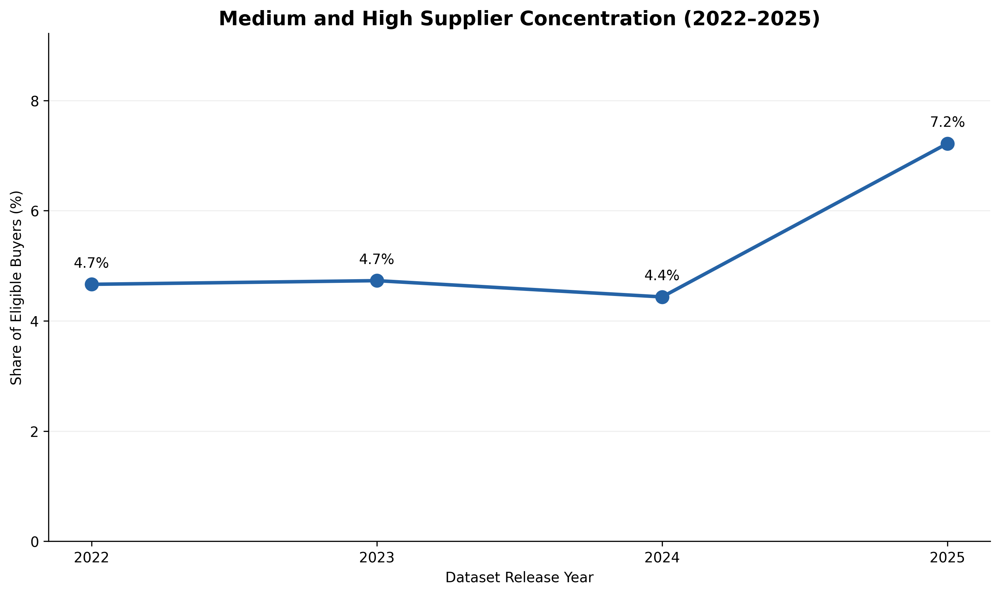
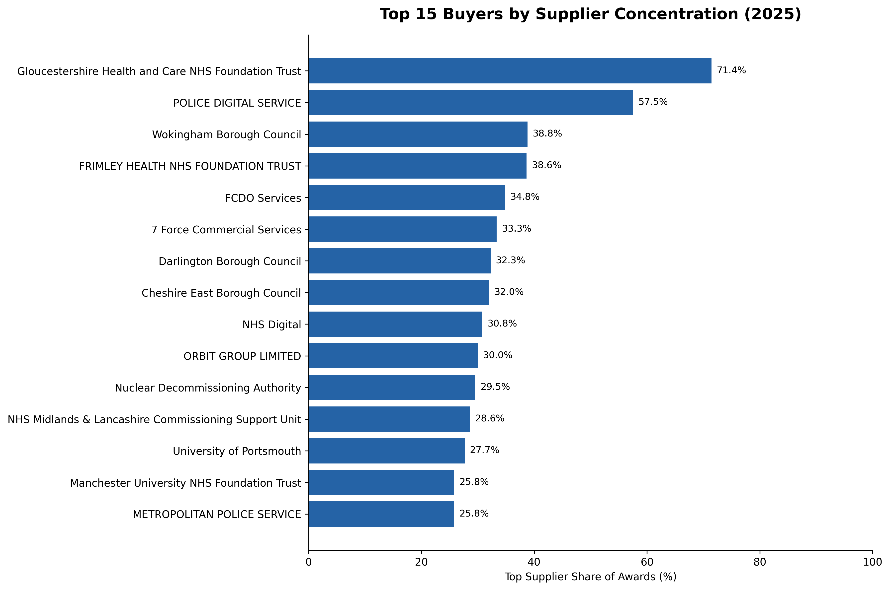
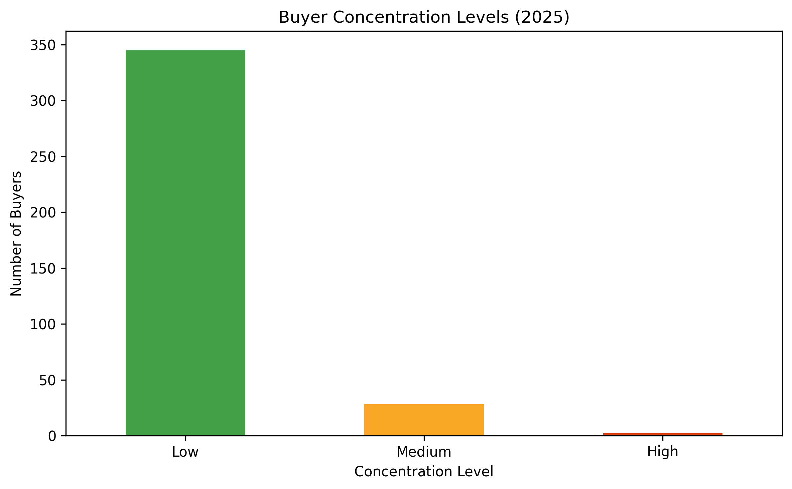

# UK Public Procurement — Supplier Concentration Analysis (2022–2025)

## Project Overview

This project analyses supplier concentration in UK public procurement using real-world Contracts Finder data from 2022 to 2025.

The objective is to explore how public sector buyers distribute contract awards among suppliers, identify potential supplier dependency indicators, and examine changes in concentration over time.

The analysis was conducted using Python, Pandas, NumPy, and Matplotlib in Google Colab.

## Data Source

**UK Contracts Finder — Open Contracting Data**

Source: https://data.open-contracting.org/en/publication/128

The analysis uses four annual dataset releases covering 2022–2025.

## Tools and Technologies

- Python
- Pandas and NumPy
- Matplotlib
- Google Colab
- Excel and CSV
- GitHub

## Methodology

The analysis involved:

1. Importing procurement, award, and supplier records from Excel datasets.
2. Matching supplier information with contract awards.
3. Identifying missing values, duplicate records, and invalid supplier names.
4. Standardising supplier names and filtering records using consistent rules.
5. Excluding multi-supplier awards and identifying framework-related tenders using keyword-based screening.
6. Calculating supplier concentration using award counts rather than financial values.
7. Comparing buyer-level concentration across four dataset release years.

Only buyers with at least 20 award records and three distinct suppliers were included in the final comparison.

### Concentration Metrics

**Top Supplier Share:** Percentage of a buyer's awards associated with its most frequently awarded supplier.

**HHI (Herfindahl-Hirschman Index):** Sum of squared supplier award shares, measuring concentration across a buyer's suppliers.

The project uses the following custom classification thresholds:

| Level | Top Supplier Share |
|---|---|
| Low | Below 20% |
| Medium | 20% to below 40% |
| High | 40% or above |

These categories are analytical indicators, not official procurement risk ratings.

## Key Results

| Year | Buyers Analysed | Low | Medium | High | Medium + High |
|---|---:|---:|---:|---:|---:|
| 2022 | 386 | 368 | 17 | 1 | 4.66% |
| 2023 | 444 | 423 | 19 | 2 | 4.73% |
| 2024 | 451 | 431 | 16 | 4 | 4.43% |
| 2025 | 374 | 347 | 25 | 2 | 7.22% |

### Key Observations

- Most eligible buyers were classified as having low supplier concentration.
- The combined proportion of medium- and high-concentration buyers increased to 7.22% in the 2025 dataset release.
- Average buyer-level HHI was approximately 0.036–0.043 across the four releases.
- Large framework agreement values and repeated award values demonstrated why recorded procurement values should not automatically be interpreted as actual expenditure.

## Visualisations

### Supplier Concentration Trend (2022–2025)

### Top 15 Buyers by Supplier Concentration (2025)

### Buyer Concentration Classification (2025)

## Repository Files

| File | Description |
|---|---|
| `Supplier_Concentration_Risk_Analysis.ipynb` | Python analysis notebook |
| `yearly_concentration_summary.csv` | Annual concentration results |
| `buyer_concentration_2022_2025.csv` | Buyer-level concentration metrics |
| `supplier_concentration_2025.png` | Top buyer concentration chart |
| `buyer_concentration_levels_2025.png` | Concentration classification chart |
| `supplier_concentration_trend_2022_2025.png` | Four-year trend chart |

## Limitations

This analysis measures concentration based on contract award counts, not actual procurement spending or supplier performance.

Supplier names may contain inconsistencies, and some framework or multi-supplier arrangements may not be fully identifiable from the available fields. The annual results represent dataset release years and should not automatically be treated as contract signing years.

High concentration can indicate a potential dependency that warrants further investigation, but it does not establish supplier unreliability, poor quality, or delivery problems.

## Conclusion

This project demonstrates how publicly available procurement data can be used to support supplier portfolio analysis and identify patterns of supplier concentration.

It highlights the importance of data cleaning, transparent methodology, and careful interpretation when developing procurement-related risk indicators.
